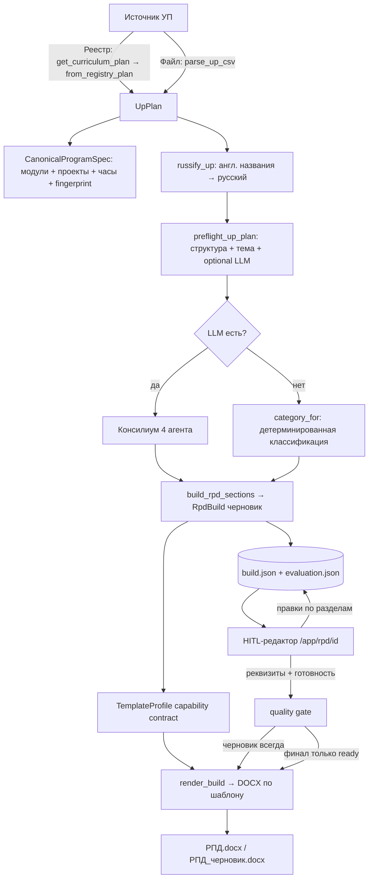

# Генератор РПД из УП (модуль `content_factory.rpd`)

Инструмент собирает **рабочую программу дисциплины (РПД)** в DOCX из **учебного плана (УП)** по
**шаблону ДПО**, с человеком в контуре (HITL): методист правит по разделам и экспортирует.

- **Режим в UI:** `/app/rpd` (плитка «РЕЖИМ / 07» на `/app`).
- **Пакет логики:** `src/content_factory/rpd/` (изолирован — легко ретайрить).
- **Web-обвязка:** `src/content_factory/api/routers/rpd.py`.

---

## 1. Подход и принципы

РПД — **финальный описывающий документ**: он не планирует, а фиксирует то, что уже собрано в УП.
Отсюда три принципа реализации:

1. **РПД = УП (источник содержания) + шаблон ДПО (форма).** УП даёт данные, шаблон — структуру и
   стандартный текст. Содержание берётся только из УП.
2. **Гибрид, а не «всё через агента» и не «всё кодом»:**
   - **Детерминированный код** — там, где переносятся ЗНАЧЕНИЯ (часы, модули, компетенции) и где
     верстается DOCX. Код компетенции не синтезируется: если его нет в УП, финальный экспорт
     блокируется до решения методиста.
   - **LLM-консилиум** — там, где нужно ПОНИМАНИЕ (предварительная классификация разделов шаблона, осмысление
     УП) и свободный ТЕКСТ (проза: цель, актуальность и т.п.).
   - **Человек** — на приёмке (редактор по разделам).
3. **Устойчивость через фолбэки:** любая LLM-стадия сбоит → откат на детерминированную классификацию;
   нет LLM → плейсхолдеры. Черновик собирается всегда, но финальный экспорт проходит только через
   quality gate; незавершённый DOCX доступен отдельно как черновик.

**Граница LLM:** модель решает **МАРШРУТ**, пишет **ПРОЗУ**, переводит текстовые поля и проверяет
соответствие названия содержанию. Часы и табличные значения переносятся кодом; все LLM-результаты
остаются черновиком до проверки человеком. Русификация — производное представление, поэтому
формулировку «дословный перенос всех текстовых значений» система не гарантирует.

**Модели:** вызовы разделены на роли `rpd_translate`, `rpd_classify`, `rpd_interpret`, `rpd_prose`,
`rpd_validate`, `rpd_repair`, `rpd_semantic_preflight`. У каждой роли отдельный client/runtime, timeout,
retries, cache-policy и опциональные `*_PROVIDER`/`*_MODEL`; без overrides используются цепочки общего
model registry. Дисковый кэш консилиума отражается в тех же role-based метриках как логические вызовы с
`cache_hit=true` и нулевой задержкой. Критик запускает один общий repair-проход по всем исправимым
замечаниям, после чего повторно проверяются только реально изменённые разделы. Версия контура
`rpd-consilium-v4`; смена версии автоматически инвалидирует старый контентный кэш. Нерешённые
LLM-флаги сохраняются только для полностью генерируемых разделов: `gap`/`platform` уже блокируются
собственными human-in-the-loop placeholder-кодами и не создают дублирующую ошибку в интерфейсе.

---

## 2. Пайплайн end-to-end

Стадии:

| # | Стадия | Что делает | LLM? |
|---|--------|-----------|------|
| 1 | **Источник УП** | Из Реестра (`get_curriculum_plan` → `from_registry_plan`) или из файла CSV (`parse_up_csv`) → нормализованный `UpPlan` | нет |
| 2 | **Русификация** | `russify_up`: переводит англоязычные названия тем/модулей/результатов; термины/имена/файлы оставляет | 1 батч |
| 3 | **Preflight** | Канонический снимок, структура модулей/проектов, часы, технические/дублирующиеся названия, тематическое соответствие названия содержанию | до 1 батч |
| 4 | **Понимание** | Консилиум (4 роли) ИЛИ детерминированный `category_for` (fallback) | до 4 батч |
| 5 | **Сборка черновика** | `build_rpd_sections` → `RpdBuild` + исходные quality findings | нет |
| 6 | **Персист** | Атомарная запись `build.json` и производного `evaluation.json` | нет |
| 7 | **Рендер** | Разделы + bindings обложки/паспорта → DOCX; комментарии удаляются | нет |
| 8 | **HITL + gate** | Реквизиты, правки, реальные коды ПК, «готово», проверка placeholders и финальный экспорт | нет |

Стоимость первого запуска зависит от размера документа: 1 semantic preflight + 1 русификация +
classify/interpret/compose + N validation-батчей; при замечаниях добавляются repair и повторная проверка
только изменённых разделов. Консилиум повторно не вызывается при совпадении его cache key. Ролевой
runtime сохраняет для каждого вызова prompt version, provider/model, latency, cache hit, token usage,
cost и тип ошибки.

---

## 3. Модель данных

### УП-источник — `up_models.py`
- `UpPlan{title, total_hours, modules: [UpModule]}`
- `UpModule{title, goals, rows: [UpRow]}` — тематический блок и его проекты; `hours`, `fmt()`,
  `control()` — производные.
- `UpRow{block_title, name, description, outcomes_know/can/skills, hours, fmt, software, p2p, skills}` —
  одна контентная единица (проект).
- Аксессоры: `all_outcomes()`, `outcomes_by_group()` (знать/уметь/владеть), `competencies()`,
  `competency_rows()`.
- Входы: `parse_up_csv(path, title)` (колонки CSV-экспорта Реестра по именам заголовков) и
  `from_registry_plan(plan_dict)` (каталожный план из БД). Оба → `UpPlan`; пустой `block_title` в
  продолжении группы наследует предыдущий тематический блок одинаково для CSV и Реестра.
- `source_fidelity.py::CanonicalProgramSpec` фиксирует порядок и названия модулей, их часы,
  количество/названия проектов, число компетенций и fingerprint. Поэтому совпадение только общей
  суммы часов больше не маскирует неверное распределение по модулям.

### Черновик РПД — `build.py`
- `RpdSection{number, title, category, label, kind: "paragraphs"|"table", paragraphs, table_header,
  table_rows, done, flag, initial_content_hash}` — один редактируемый раздел; hash нужен для пилотной
  метрики «принято без правок».
- `RpdDocumentFields` — реквизиты обложки и паспорта, которых нет в УП: организация, согласование,
  приказ, аудитория, форма обучения, аттестация, документ, город и год.
- `RpdBuild{schema_version, revision, template_profile_id, template_report, program_title, total_hours,
  source_spec, document_fields, sections, preflight_issues, quality, generation_trace}` — версионированный черновик
  целиком; сериализуется в `build.json`.
- `RpdQualityReport{issues}` — typed findings со стабильными кодами, severity и blocking-флагом.
- `RpdGenerationTrace` — fingerprints УП/шаблона, длительность сборки и LLM events.
- `RpdEvaluationArtifact` — агрегируемые пилотные метрики: readiness, правки, acceptance rate,
  blocking-коды, latency/tokens/cost/failures по LLM-роли.

---

## 4. Консилиум из агентов — `consilium.py`

При наличии LLM `build_rpd_sections` вызывает `run_consilium(sections, up, client)`, возвращающий
`(roles, texts, flags)`:

| Агент | Функция | Роль |
|-------|---------|------|
| 1. Аналитик шаблона | `_classify_sections` | Классифицирует разделы ЛЮБОГО шаблона по роли. Контейнеры берутся из фактического тела шаблона (`is_container`); иерархия номера остаётся fallback для старых вызовов. |
| 2. Интерпретатор УП | `_interpret_up` | Создаёт structured content contract: назначение, обязательные тезисы, уникальный фокус и запреты на повтор. |
| 3. Сборщик | `_compose_prose` | Видит контент-план всех прозаических разделов и пишет их как единый документ. |
| 4. Критик | `_validate_prose` | Проверяет полные тексты, включая межраздельное дублирование; точные длинные повторы дополнительно ловятся кодом. |
| Repair | `_repair_repetition` | Один раз переписывает разделы с замечаниями критика и запускает повторную проверку только изменённых разделов. |

- Первые три агента делают по **одному батч-вызову** (JSON); критик делит большой набор на несколько
  запросов, сохраняя каждый раздел целиком. Repair вызывается при исправимых замечаниях. Парсинг лениентный
  (`_extract_json`). Ложный флаг «текст оборван» отбрасывается, если полный текст завершается пунктуацией.
- **Кэш** (`_cache_key`/`_cache_read`/`_cache_write`) — на диске (`temp/rpd_consilium_cache`), ключ =
  `sha256(PROMPT_VERSION + разделы + up.model_dump())`. Повторная сборка бесплатна; при правке УП или
  бампе `PROMPT_VERSION` кэш инвалидируется.
- **Fallback:** любой сбой (или пустой ответ) → `run_consilium` вернёт пустое → `build` откатится на
  `category_for`. Прозу тогда даёт `prose.generate_prose` (по-разделно) или плейсхолдер.

Детерминированная страховка — `dpo_spec.category_for(number, title)`: сопоставление по ключевым словам
заголовка под встроенный ПК-шаблон.

---

## 5. Шаблон ДПО — `template.py` + `template_profiles.py`

- Встроенный шаблон-ресурс: `rpd/templates/dpo_pk_skeleton.docx` (реальный ДПО «повышение
  квалификации» с комментариями-правилами методиста, из которых выведена спека `dpo_spec`).
- `load_rpd_template(path)` разбирает шаблон в целевой список разделов (через `ingest.parse_dpo_program`).
- `TemplateProfile` — seam формата: распознавание/capabilities, fallback-классификация, схемы таблиц,
  bindings обложки и паспорта. `BuiltinPkProfile` — первая production-реализация (`dpo_pk_v1`).
- `detect_template_profile(path)` проверяет DOCX по зарегистрированным capability-контрактам. Неизвестный
  или неоднозначный формат завершается явным `UnsupportedTemplateProfileError`, без угадывания.
- В `build.json` сохраняются `template_profile_id`, SHA-256 шаблона и `TemplateCapabilityReport`.
- Контракт ПК-профиля проверяет bindings, ключевые заголовки и их уникальную нумерацию, точные схемы
  таблиц, а также четыре Word-секции с альбомной частью. Техническое «похож на шаблон» больше не
  считается достаточной совместимостью.
- **Поддерживаемый production-контракт сейчас:** встроенный шаблон повышения квалификации.
  Классификатор может предложить роли разделов другого шаблона, но для production нужны отдельные
  bindings обложки/паспорта, проверка таблиц и golden-тест. Одной замены DOCX недостаточно.

---

## 6. Сборка и рендер

- **`build.py::build_rpd_sections(up, template_path, llm_client, template_profile_id)`** — оркестратор:
  грузит профиль/шаблон →
  консилиум/`category_for` → на каждый раздел `_section_content`:
  - `up_plan/up_grafik/up_modules/up_comp` → **таблица** из УП (детерминированно, точные колонки шаблона);
    `3.3.1` содержит все проекты и отдельный LMS-маркер для каждого модуля;
  - `generate` → проза (консилиум или `generate_prose`);
  - `platform`/`gap` → общий черновик + пометка `[Методист: …]`;
  - `boilerplate` → раздел пропускается (текст держит шаблон).
- **`render_selective.py::render_build(build, template_path)`** — получает bindings и табличный контракт
  из сохранённого профиля, идёт по шаблону, editable-разделы
  заменяет содержимым черновика, boilerplate держит; section-break paragraphs сохраняются, поэтому
  портретные/альбомные части не схлопываются. Таблицы клонируются из совпадающей схемы шаблона и
  сохраняют ширины, границы, заливку и типографику. `_drop_comments` вырезает комментарии методиста,
  bindings заполняют обложку и паспорт, демонстрационные значения очищаются. `render_rpd_pk` —
  обёртка build+render.

Таблицы УП по колонкам шаблона:

| Раздел | Колонки |
|--------|---------|
| Учебный план | № · Наименование модуля · Всего · Лекции · Практические занятия · Самостоятельная работа · Контроль (внутр. школа — часы в «Практические занятия») |
| Календарный график | Компонент · Период · Часы · Форма · Контроль |
| Рабочие программы модулей | № · Тема и краткое содержание (по проектам) · Вид работы · Часы · Методы · Контроль + evidence-marker LMS по каждому модулю |
| Компетенции | Код · Профессиональная компетенция · Исходный уровень · Качественное изменение · После обучения слушатель способен · Основание · Оценка |

---

## 7. HITL-редактор — `api/routers/rpd.py`

Экран `/app/rpd/{run_id}` грузит `build.json`:
- **Quality summary**: blocking findings, предупреждения и состояние готовности к финальному экспорту.
- **Реквизиты документа**: отдельная форма для обложки и паспорта.
- **Optimistic locking**: каждая форма передаёт `revision`; устаревшая вкладка получает HTTP 409 и не
  перезаписывает более свежую методическую правку. Ответ — HTML-экран с переходом к актуальной версии,
  а не сырой JSON FastAPI.
- **Навигатор разделов** слева: ярлык источника (из УП / сгенерировано / форма ДПО / методист / с
  платформы), ✓ у готовых, ⚠ у разделов с замечанием валидатора.
- **Редактор** справа: проза → `textarea`; таблица → редактируемая сетка с **«+ строка»** и **«×»**
  (сериализуется в `table_json` при сохранении); чекбокс **«Готово»**; замечание валидатора над разделом.
- **Черновой экспорт** доступен всегда (`?draft=true`).
- **Финальный экспорт** повторно валидирует отрендеренный DOCX и возвращает `409`, пока есть
  placeholders, демонстрационный текст, незакрытые замечания, неподтверждённые разделы или пустые ПК.

Роуты (`page_router`, префикс `/app/rpd`):

| Метод · путь | Назначение |
|--------------|-----------|
| `GET ""` / `GET "/"` | Главная: ввод названия + загрузка УП-CSV + список Реестра |
| `POST /upload` | Приём CSV-файла УП (upload-on-select) |
| `POST /generate` | Сборка РПД из загруженного CSV |
| `GET /registry` | JSON-список планов Реестра (`list_curriculum_plans`) |
| `POST /registry/{plan_id}` | Сборка РПД из выбранного плана Реестра |
| `GET /{run_id}?s=` | Редактор (раздел `s`) |
| `POST /{run_id}/section/{index}` | Сохранить раздел (текст / `table_json` / `done`) |
| `POST /{run_id}/metadata` | Сохранить реквизиты обложки и паспорта |
| `GET /{run_id}/download` | Финальный DOCX, только если quality gate пройден |
| `GET /{run_id}/download?draft=true` | Черновой DOCX независимо от готовности |
| `GET /{run_id}/evaluation` | Актуальный JSON пилотных метрик |
| `POST /{run_id}/delete` | Удалить прогон |

Прогоны персистятся (`rpd_meta.json` + `build.json` + `evaluation.json` + `РПД.docx`), переживают рестарт,
переоткрываются и удаляются; на пользователя — до 12 (LRU-эвикция).

---

## 8. Карта файлов

| Файл | Ответственность |
|------|-----------------|
| `up_models.py` | Модель УП + `parse_up_csv` + `from_registry_plan` |
| `source_fidelity.py` | Канонический глубокий снимок УП и стабильный fingerprint |
| `template.py` | Загрузка шаблона + пути ресурсов |
| `template_profiles.py` | Profile interface, capability detection, ПК-bindings и табличные схемы |
| `ingest.py` / `models.py` | Разбор DOCX-шаблона в разделы (переиспользуется для шаблона) |
| `dpo_spec.py` | Детерминированная классификация разделов (fallback) |
| `consilium.py` | 4 LLM-агента + кэш |
| `prose.py` | По-разделная генерация прозы (fallback) + контекст УП |
| `translate.py` | Русификация англоязычных данных УП |
| `quality.py` | Source preflight, optional LLM semantic check, DOCX/readiness validation |
| `llm_runtime.py` | Ролевой model routing + latency/token/cost/failure telemetry |
| `evaluation.py` | Детерминированный pilot artifact и агрегация LLM-метрик |
| `build.py` | Сборка `RpdBuild` (оркестратор консилиум/детерминизм) |
| `render_selective.py` | `RpdBuild` → DOCX (+ вырезание комментов, границы) |
| `render_docx.py` / `transfer.py` | Legacy-путь (образец `_итог`), `GAP_MARKER` |
| `templates/*.docx` | Встроенные шаблоны-ресурсы |
| `api/routers/rpd.py` | Web: источники, генерация, редактор, экспорт, персист |

---

## 9. Устойчивость и границы

**Фолбэки:** консилиум-сбой → `category_for`; нет LLM → плейсхолдеры; кэш/русификация/валидатор —
best-effort (сбой не ломает черновик). Ошибка semantic preflight становится видимым warning. Проблемы
не скрываются под статусом «готово»: финальный экспорт блокируется, черновой остаётся доступен.
Quality gate дополнительно сверяет таблицы плана/графика, проекты и число компетенций с
`CanonicalProgramSpec`, ищет placeholders и в ячейках, а у отрендеренного DOCX сравнивает секции и
ориентацию с capability-контрактом шаблона.

**Не входит (осознанно):** авторское заполнение смысловых пробелов сверх УП; вузовские шаблоны и подвиды
ДПО тумблером; редактор «критичных изменений» в стиле было-стало.

**Настройка LLM-ролей:** префиксы `RPD_LLM_TRANSLATE`, `RPD_LLM_CLASSIFY`, `RPD_LLM_INTERPRET`,
`RPD_LLM_PROSE`, `RPD_LLM_VALIDATE`, `RPD_LLM_SEMANTIC_PREFLIGHT`; суффиксы `_PROVIDER`, `_MODEL`,
`_TIMEOUT_SECONDS`, `_MAX_RETRIES`. Например, `RPD_LLM_PROSE_MODEL` задаёт дешёвую prose-модель,
не меняя critic/preflight. Cache включён для translate/classify/interpret/prose/preflight и отключён
для финального критика.

**Расширения (по желанию):** предпросмотр DOCX в браузере; «отметить всё готово → финал»;
prompt A/B и агрегатор нескольких `evaluation.json` для пилотного дашборда.

---

## 10. Тесты

`tests/rpd/`: `test_up_csv` (парсер УП + golden-профиль `curriculum_plan_14` на 478 часов), `test_up_transfer`/`test_transfer` (маппинг), `test_build`
(черновик), `test_render_pk`/`test_render` (рендер, no-leak, границы), `test_prose`/`test_translate`
(генерация, русификация), `test_consilium` (4 агента, кэш, флаги, fallback), `test_router` (web:
загрузка/генерация/редактор/правки/черновой и финальный экспорт/персист), `test_quality` (дробные
часы, полнота адаптера Реестра, structured LLM mismatch, cover bindings, no-example/no-placeholder,
readiness gate), `test_template_profiles` (capabilities/fingerprint/unsupported), `test_llm_runtime`
(role routing/config/telemetry), `test_evaluation` (acceptance/edit/cost/latency). Гейты: `ruff`,
`mypy src/content_factory/rpd`, `pytest tests/rpd`.

`test_quality_live_llm` — opt-in eval на четырёх позитивных/негативных семантических парах. Он
реальным LLM-вызовом проверяет accuracy, recall несоответствий и specificity совпадений. Запуск:
`RUN_RPD_LLM_EVAL=1 pytest tests/rpd/test_quality_live_llm.py -s`; провайдер и модель можно задать
через `RPD_LLM_EVAL_PROVIDER` и `RPD_LLM_EVAL_MODEL`. Обычный suite не расходует API-квоту.

---

## 11. Где менять код без поломок (blast radius)

Весь модуль: `src/content_factory/rpd/*` + `api/routers/rpd.py` + одна строка
`app.include_router(rpd.page_router)` в `main.py` + плитка в `static/app.html`. Отключить режим =
закомментировать include.

**Центральные связи (что от чего зависит — трогай осознанно):**
- **`RpdSection` (`build.py`) — главный контракт.** Его поля читают: `render_selective.render_build`,
  редактор `_render_editor`, сохранение `rpd_save_section`, файл `build.json`. Меняешь поля → правь все
  четыре + тесты. Добавить поле с дефолтом — безопасно (pydantic доберёт); переименовать/удалить —
  ломает старые `build.json`.
- **Роли ↔ категории.** Значения `dpo_spec.Cat` и ключи `consilium._ROLES` **должны совпадать** (роль от
  агента → `Cat(role)`). Добавляешь роль — правь ОБА + `build._CATEGORY_LABEL` (ярлык в UI) +
  `build._section_content` (как наполнять).
- **Ключ раздела** `f"{number} {title}"` (`consilium.section_key`) — единый ID между консилиумом, `build`
  и роутером. Не меняй формат в одном месте.
- **`PROMPT_VERSION` (`consilium.py`) — бампай при ЛЮБОЙ правке промптов консилиума**, иначе кэш вернёт
  старое.
- **Смена шаблона-ресурса** — консилиум (агент 1) классифицирует новый сам; но `category_for` (fallback)
  заточен под ПК-шаблон → при работе без LLM обнови ключевые слова в `dpo_spec`.

**«Хочу изменить → где править → что прогнать»:**

| Изменение | Правь | Прогнать |
|---|---|---|
| Колонки/данные УП-таблицы | `build._uchebnyi_plan/_grafik/_modules/_competencies` | `test_build`, `test_render_pk` |
| Формат/колонки CSV УП | `up_models.parse_up_csv` (`_find` по заголовкам) | `test_up_csv` |
| Правила классификации разделов | `consilium._ROLES` + `dpo_spec.category_for` + `PROMPT_VERSION`↑ | `test_consilium`, `test_render_pk` |
| Промпты ТЗ/сборки/валидатора | `consilium._interpret_up/_compose_prose/_validate_prose` + `PROMPT_VERSION`↑ | `test_consilium` |
| Проза-fallback (без консилиума) | `prose._PROMPTS`/`_up_context` | `test_prose` |
| Вёрстка DOCX / границы / комменты | `render_selective` (`render_build`,`_build_table`,`_drop_comments`) | `test_render_pk`, `test_build` |
| Экран редактора / навигатор / флаги | `rpd._render_editor`/`_EDITOR_TEMPLATE`/`_render_table_editor` | `test_router` |
| Сохранение раздела | `rpd_save_section` + `_table_from_json` | `test_router` |
| Роуты/источники (CSV/Реестр) | `rpd_generate`/`rpd_from_registry`/`_build_from_up` | `test_router` |
| Модель/провайдер/роль LLM | `_llm_client` (роутер) + `.env` (POLZA_*) | проверить на сервере |

---

## 12. Агенты и модели — детально

**Единая модель на все LLM-вызовы** (пока не разведено по ролям):

| Параметр | Значение | Источник |
|---|---|---|
| Провайдер | Polza (`LLM_PROVIDER=polza`, base `https://polza.ai/api/v1`) | `.env` / `model_registry` |
| Модель | `openai/gpt-5.4-mini` | `.env POLZA_AI_MODEL` |
| Роль | `default` | `_llm_client()` |
| Temperature | 0.4 | `.env POLZA_AI_TEMPERATURE` |
| Timeout | 90 c | `.env POLZA_AI_TIMEOUT_SECONDS` |
| Кэш клиента | вкл (`enable_cache=True`) | `_llm_client()` |

Клиент создаётся один раз на сборку — `create_llm_client(default_role="default", enable_cache=True)` в
`_llm_client()` (`api/routers/rpd.py`) — и передаётся во все стадии; при недоступности → `None` → фолбэк.
Каждый вызов = один батч-запрос `client.complete(system, user)` → текст → ленивый JSON-парсинг.

| Вызов | Файл · функция | Вход → Выход | Когда |
|---|---|---|---|
| Русификация | `translate.russify_up` | англ. значения УП → `{ориг: перевод}` | всегда, перед консилиумом |
| Semantic preflight | `quality.preflight_up_plan` | название + содержание → typed consistency assessment | при наличии клиента и проектов |
| **Агент 1** — аналитик шаблона | `consilium._classify_sections` | разделы шаблона → `{раздел: роль}` | консилиум |
| **Агент 2** — интерпретатор УП | `consilium._interpret_up` | прозаические разделы + УП → `{раздел: content contract}` | если есть прозаические разделы |
| **Агент 3** — сборщик | `consilium._compose_prose` | ТЗ + УП → `{раздел: текст}` | -//- |
| **Агент 4** — критик | `consilium._validate_prose` | тексты + УП → `{раздел: замечание}` (только проблемные) | -//- |
| Repair повторов | `consilium._repair_repetition` | все тексты + контракты + замечания → исправленные проблемные разделы | только при повторе, один проход |
| Проза-fallback | `prose.generate_prose` | заголовок + УП → абзацы | только если консилиум пуст/сбой |

**Итого на обычную первую сборку:** 1 (русификация) + 1 (semantic preflight) + до 4 (консилиум) = до 6
батч-вызовов. При обнаруженном повторе добавляются repair и повторная проверка. Повтор того же УП+шаблона не вызывает консилиум благодаря его кэшу
(`temp/rpd_consilium_cache`, ключ `sha256(PROMPT_VERSION + разделы + УП)`); остальные стадии используют
кэш общего LLM-клиента.

**Заземление:** значения УП-таблиц идут мимо генератора прозы; агенты
получают ТОЛЬКО данные УП (`consilium`/`prose._up_context`: тема, объём, модули, компетенции, результаты)
и промпт-запрет на выдуманные факты и лишний английский. Агент-критик даёт blocking finding, а
детерминированный gate проверяет структуру, placeholders и готовность независимо от модели.

**Как сменить модель/роль:**
- Быстро (вся проза): `.env POLZA_AI_MODEL=<другая>` / `POLZA_AI_TEMPERATURE`.
- Правильно (развести роли): в `_llm_client()` дать роль `rpd_prose`, прописать её в `model_registry` на
  дешёвую быструю модель (проза простая; классификация/перевод — точнее). Пока не сделано — см. «Расширения».
