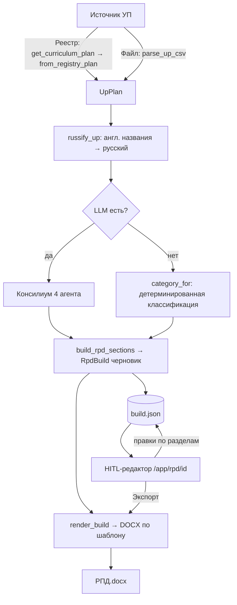

# Генератор РПД из УП (модуль `content_factory.rpd`)

Инструмент собирает **рабочую программу дисциплины (РПД)** в DOCX из **учебного плана (УП)** по
**шаблону ДПО**, с человеком в контуре (HITL): методист правит по разделам и экспортирует.

- **Режим в UI:** `/app/rpd` (плитка «РЕЖИМ / 07» на `/app`).
- **Пакет логики:** `src/content_factory/rpd/` (изолирован — легко ретайрить).
- **Web-обвязка:** `src/content_factory/api/routers/rpd.py`.

---

## 1. Подход и принципы

РПД — **финальный описывающий документ**: он не планирует, а фиксирует то, что уже собрано в УП.
Отсюда три принципа реализации:

1. **РПД = УП (источник содержания) + шаблон ДПО (форма).** УП даёт данные, шаблон — структуру и
   стандартный текст. Содержание берётся только из УП.
2. **Гибрид, а не «всё через агента» и не «всё кодом»:**
   - **Детерминированный код** — там, где переносятся ЗНАЧЕНИЯ (часы, модули, компетенции) и где
     верстается DOCX. Ноль галлюцинаций, аудируемость, требование «без домыслов».
   - **LLM-консилиум** — там, где нужно ПОНИМАНИЕ (классификация разделов любого шаблона, осмысление
     УП) и свободный ТЕКСТ (проза: цель, актуальность и т.п.).
   - **Человек** — на приёмке (редактор по разделам).
3. **Устойчивость через фолбэки:** любая LLM-стадия сбоит → откат на детерминированную классификацию;
   нет LLM → плейсхолдеры. Документ собирается всегда.

**Ключ, почему «без домыслов» сохраняется:** LLM решает **МАРШРУТ** (что куда, что чем закрыть) и
пишет **ПРОЗУ**; **значения** (цифры, названия модулей, коды компетенций) переносит код дословно —
LLM их не трогает.

**Модель:** `openai/gpt-5.4-mini` через Polza (`LLM_PROVIDER=polza`, роль `default`), temp 0.4.

---

## 2. Пайплайн end-to-end

Стадии:

| # | Стадия | Что делает | LLM? |
|---|--------|-----------|------|
| 1 | **Источник УП** | Из Реестра (`get_curriculum_plan` → `from_registry_plan`) или из файла CSV (`parse_up_csv`) → нормализованный `UpPlan` | нет |
| 2 | **Русификация** | `russify_up`: переводит англоязычные названия тем/модулей/результатов; термины/имена/файлы оставляет | 1 батч |
| 3 | **Понимание** | Консилиум (4 агента) ИЛИ детерминированный `category_for` (fallback) | до 4 батч |
| 4 | **Сборка черновика** | `build_rpd_sections` → `RpdBuild`: разделы с типом (таблица/проза), ярлыком источника, флагами валидатора | нет |
| 5 | **Персист** | `build.json` в папке прогона — для редактора | нет |
| 6 | **Рендер** | `render_build`: кладёт черновик в DOCX-шаблон, вырезает комментарии, ставит границы таблиц | нет |
| 7 | **HITL-редактор** | Правки по разделам, add/delete строк, «готово», флаги; экспорт из отредактированного черновика | нет |

Стоимость: ~5 батч-вызовов на первую сборку (1 русификация + до 4 консилиума); **повтор того же
УП+шаблона — из кэша, 0 вызовов.**

---

## 3. Модель данных

### УП-источник — `up_models.py`
- `UpPlan{title, total_hours, modules: [UpModule]}`
- `UpModule{title, goals, rows: [UpRow]}` — тематический блок и его проекты; `hours`, `fmt()`,
  `control()` — производные.
- `UpRow{block_title, name, description, outcomes_know/can/skills, hours, fmt, software, p2p, skills}` —
  одна контентная единица (проект).
- Аксессоры: `all_outcomes()`, `outcomes_by_group()` (знать/уметь/владеть), `competencies()`,
  `competency_rows()`.
- Входы: `parse_up_csv(path, title)` (колонки CSV-экспорта Реестра по именам заголовков) и
  `from_registry_plan(plan_dict)` (каталожный план из БД). Оба → `UpPlan`.

### Черновик РПД — `build.py`
- `RpdSection{number, title, category, label, kind: "paragraphs"|"table", paragraphs, table_header,
  table_rows, done, flag}` — один редактируемый раздел.
- `RpdBuild{program_title, sections: [RpdSection]}` — черновик целиком; сериализуется в `build.json`.

---

## 4. Консилиум из агентов — `consilium.py`

При наличии LLM `build_rpd_sections` вызывает `run_consilium(sections, up, client)`, возвращающий
`(roles, texts, flags)`:

| Агент | Функция | Роль |
|-------|---------|------|
| 1. Аналитик шаблона | `_classify_sections` | Классифицирует разделы ЛЮБОГО шаблона по роли (`up_plan`, `generate`, `boilerplate`, `gap`, `platform`…). Заменяет хардкод. |
| 2. Интерпретатор УП | `_interpret_up` | На каждый прозаический раздел — краткое ТЗ по смыслу УП. |
| 3. Сборщик | `_compose_prose` | Официальный русский текст раздела по ТЗ + данным УП. |
| 4. Критик | `_validate_prose` | Проверка (русский / привязка к УП / без выдумок) → замечания только по проблемным. |

- Каждый агент — **один батч-вызов** (JSON), парсинг лениентный (`_extract_json`).
- **Кэш** (`_cache_key`/`_cache_read`/`_cache_write`) — на диске (`temp/rpd_consilium_cache`), ключ =
  `sha256(PROMPT_VERSION + разделы + up.model_dump())`. Повторная сборка бесплатна; при правке УП или
  бампе `PROMPT_VERSION` кэш инвалидируется.
- **Fallback:** любой сбой (или пустой ответ) → `run_consilium` вернёт пустое → `build` откатится на
  `category_for`. Прозу тогда даёт `prose.generate_prose` (по-разделно) или плейсхолдер.

Детерминированная страховка — `dpo_spec.category_for(number, title)`: сопоставление по ключевым словам
заголовка под встроенный ПК-шаблон.

---

## 5. Шаблон ДПО — `template.py`

- Встроенный шаблон-ресурс: `rpd/templates/dpo_pk_skeleton.docx` (реальный ДПО «повышение
  квалификации» с комментариями-правилами методиста, из которых выведена спека `dpo_spec`).
- `load_rpd_template(path)` разбирает шаблон в целевой список разделов (через `ingest.parse_dpo_program`).
- **Сменяемость:** при приходе другого шаблона (переподготовка / вуз) достаточно заменить файл-ресурс;
  консилиум (агент 1) классифицирует его разделы сам. `category_for` — только страховка под ПК-шаблон.

---

## 6. Сборка и рендер

- **`build.py::build_rpd_sections(up, template_path, llm_client)`** — оркестратор: грузит шаблон →
  консилиум/`category_for` → на каждый раздел `_section_content`:
  - `up_plan/up_grafik/up_modules/up_comp` → **таблица** из УП (детерминированно, точные колонки шаблона);
  - `generate` → проза (консилиум или `generate_prose`);
  - `platform`/`gap` → общий черновик + пометка `[Методист: …]`;
  - `boilerplate` → раздел пропускается (текст держит шаблон).
- **`render_selective.py::render_build(build, template_path)`** — идёт по шаблону, editable-разделы
  заменяет содержимым черновика, boilerplate держит; `_drop_comments` вырезает комментарии методиста,
  `_set_grid_borders` ставит границы таблиц. `render_rpd_pk` — обёртка build+render.

Таблицы УП по колонкам шаблона:

| Раздел | Колонки |
|--------|---------|
| Учебный план | № · Модуль · Всего · Лекции · Практические · Самост · Контроль (внутр. школа — часы в «Практические») |
| Календарный график | Компонент · Период · Часы · Форма · Контроль |
| Рабочие программы модулей | № · Тема и содержание (по проектам) · Вид работы · Часы · Методы · Контроль |
| Компетенции | Код · ПК · Исходный · Качественное изменение · После обучения · Основание |

---

## 7. HITL-редактор — `api/routers/rpd.py`

Экран `/app/rpd/{run_id}` грузит `build.json`:
- **Навигатор разделов** слева: ярлык источника (из УП / сгенерировано / форма ДПО / методист / с
  платформы), ✓ у готовых, ⚠ у разделов с замечанием валидатора.
- **Редактор** справа: проза → `textarea`; таблица → редактируемая сетка с **«+ строка»** и **«×»**
  (сериализуется в `table_json` при сохранении); чекбокс **«Готово»**; замечание валидатора над разделом.
- **Экспорт** рендерит DOCX из **текущего (отредактированного)** черновика.

Роуты (`page_router`, префикс `/app/rpd`):

| Метод · путь | Назначение |
|--------------|-----------|
| `GET ""` / `GET "/"` | Главная: ввод названия + загрузка УП-CSV + список Реестра |
| `POST /upload` | Приём CSV-файла УП (upload-on-select) |
| `POST /generate` | Сборка РПД из загруженного CSV |
| `GET /registry` | JSON-список планов Реестра (`list_curriculum_plans`) |
| `POST /registry/{plan_id}` | Сборка РПД из выбранного плана Реестра |
| `GET /{run_id}?s=` | Редактор (раздел `s`) |
| `POST /{run_id}/section/{index}` | Сохранить раздел (текст / `table_json` / `done`) |
| `GET /{run_id}/download` | Экспорт DOCX из отредактированного черновика |
| `POST /{run_id}/delete` | Удалить прогон |

Прогоны персистятся (`rpd_meta.json` + `build.json` + `РПД.docx` в папке прогона), переживают рестарт,
переоткрываются и удаляются; на пользователя — до 12 (LRU-эвикция).

---

## 8. Карта файлов

| Файл | Ответственность |
|------|-----------------|
| `up_models.py` | Модель УП + `parse_up_csv` + `from_registry_plan` |
| `template.py` | Загрузка шаблона + пути ресурсов |
| `ingest.py` / `models.py` | Разбор DOCX-шаблона в разделы (переиспользуется для шаблона) |
| `dpo_spec.py` | Детерминированная классификация разделов (fallback) |
| `consilium.py` | 4 LLM-агента + кэш |
| `prose.py` | По-разделная генерация прозы (fallback) + контекст УП |
| `translate.py` | Русификация англоязычных данных УП |
| `build.py` | Сборка `RpdBuild` (оркестратор консилиум/детерминизм) |
| `render_selective.py` | `RpdBuild` → DOCX (+ вырезание комментов, границы) |
| `render_docx.py` / `transfer.py` | Legacy-путь (образец `_итог`), `GAP_MARKER` |
| `templates/*.docx` | Встроенные шаблоны-ресурсы |
| `api/routers/rpd.py` | Web: источники, генерация, редактор, экспорт, персист |

---

## 9. Устойчивость и границы

**Фолбэки:** консилиум-сбой → `category_for`; нет LLM → плейсхолдеры; кэш/русификация/валидатор —
best-effort (сбой не ломает сборку); разработчиков (имена) не генерируем — только пометка методисту;
разделы «с платформы» (скрины заданий) авто не закрываются — пометка.

**Не входит (осознанно):** авторское заполнение смысловых пробелов сверх УП; вузовские шаблоны и подвиды
ДПО тумблером; редактор «критичных изменений» в стиле было-стало.

**Расширения (по желанию):** отдельная дешёвая модель-роль `rpd_prose`; предпросмотр DOCX в браузере;
«отметить всё готово → финал»; версионирование промптов через `PROMPT_VERSION` + A/B.

---

## 10. Тесты

`tests/rpd/`: `test_up_csv` (парсер УП), `test_up_transfer`/`test_transfer` (маппинг), `test_build`
(черновик), `test_render_pk`/`test_render` (рендер, no-leak, границы), `test_prose`/`test_translate`
(генерация, русификация), `test_consilium` (4 агента, кэш, флаги, fallback), `test_router` (web:
загрузка/генерация/редактор/правки/экспорт/персист). Гейты: `ruff`, `mypy src/content_factory/rpd`,
`pytest tests/rpd`.
